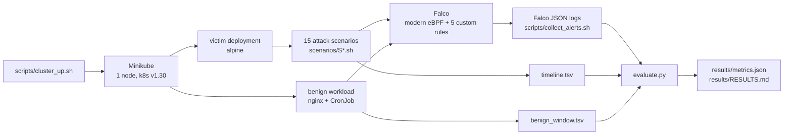

# k8s-threat-detection-lab

Attack simulations against a local Kubernetes cluster, detected by Falco, with measured
detection and false-alert rates. Everything is reproducible with the scripts in this repo.

> Results are generated by `evaluate.py` from the raw Falco output. They are added after the
> first real CI run — no number in this repository is estimated.

## Why

Endpoint detection (Sigma on Windows telemetry) and DevOps are covered by my other projects.
This one covers the gap between them: **runtime detection inside Kubernetes** — what an attacker
does once they have a pod, and what a default Falco installation actually sees.

## How it works



- **Ground truth first:** `scenarios/expected.yaml` lists, per scenario, the rule names that count
  as a detection. It was committed before the first evaluation run (see the first commit).
- **v1 vs v2:** v1 counts only alerts from Falco's default rules. v2 counts default + the five
  rules in `rules/custom_rules.yaml`. One run is enough because custom rules are identified by name.
- **Benign window:** nginx, a CronJob, a rolling update and normal debugging `kubectl exec` run
  for 15 minutes. Alerts in that window are reported per hour.

## Results

See [`results/RESULTS.md`](results/RESULTS.md) and the machine-readable
[`results/metrics.json`](results/metrics.json).

## How to run

```bash
bash scripts/cluster_up.sh
bash scripts/install_falco.sh
bash scripts/collect_alerts.sh results/alerts.jsonl &   # second shell is fine
bash scripts/run_scenarios.sh
bash scenarios/benign.sh
kill %1
python evaluate.py
```

Requirements: Docker, Minikube, kubectl, Helm 3, Python 3.12. The full lab also runs in GitHub
Actions (`.github/workflows/ci.yml`, job "Full lab on Minikube").

## Tests

```bash
python -m venv .venv && . .venv/bin/activate
pip install -r requirements-dev.txt
ruff check . && pytest -q
```

## Limitations

- One-node Minikube with a modern eBPF driver, not a managed production cluster.
- 15 scenarios is a sample; it is not a benchmark of Falco.
- The benign window is 15 minutes, so the alerts/hour figure has a wide confidence interval.
- Falco's default ruleset changes between releases; every version is pinned in `SOURCES.md`.
- k8saudit-only techniques (for example creating a `cluster-admin` binding) are out of scope:
  the plugin and API-server audit webhook are not enabled here.

## Sources and licence

See [`SOURCES.md`](SOURCES.md). Code: MIT.

## Author

**Youssef Bouaouina** — [github.com/youssefbouaouina](https://github.com/youssefbouaouina) ·
[portfolio](https://youssefbouaouina.github.io/) ·
[AD Detection Lab](https://youssefbouaouina.github.io/ad-detection-lab/)
