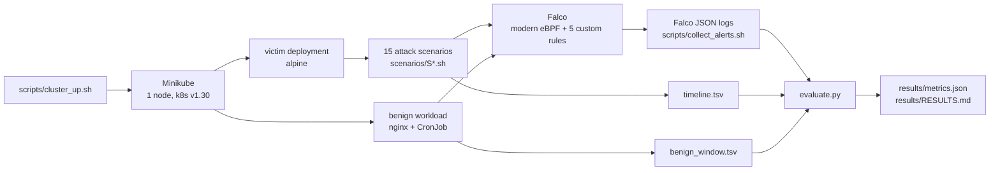

# k8s-threat-detection-lab

[](https://github.com/youssefbouaouina/k8s-threat-detection-lab/actions/workflows/ci.yml)
[](LICENSE)


Attack simulations against a local Kubernetes cluster, detected by Falco, with measured
detection and false-alert rates. Everything is reproducible with the scripts in this repo.

## Why

Endpoint detection (Sigma on Windows telemetry) and DevOps are covered by my other projects.
This one covers the gap between them: **runtime detection inside Kubernetes** — what an attacker
does once they have a pod, and what a default Falco installation actually sees.

## How it works



- **Ground truth first:** `scenarios/expected.yaml` lists, per scenario, the rule names that count
  as a detection. It was committed before the first evaluation run (see the first commit).
- **v1 vs v2:** v1 counts only alerts from Falco's default rules. v2 counts default + the five
  rules in `rules/custom_rules.yaml`. One run is enough because custom rules are identified by name.
- **Benign window:** nginx, a CronJob, a rolling update and normal debugging `kubectl exec` run
  for 15 minutes. Alerts in that window are reported per hour.

## Results

CI run #4, 2026-11-05, one-node Minikube, Falco 0.45.2 (modern eBPF). Every number comes from
[`results/metrics.json`](results/metrics.json); the raw alerts are in
[`results/alerts.jsonl`](results/alerts.jsonl) and the per-scenario detail in
[`results/RESULTS.md`](results/RESULTS.md).

| Metric | v1 (default rules) | v2 (default + custom) |
|---|---|---|
| Scenarios detected | 3/15 (20.0%) | **5/15 (33.3%)** |
| Alerts collected | 66 | 66 |
| Benign window | 15.4 min | 15.4 min |
| Benign alerts | 52 | 52 |
| Benign alerts per hour | 202.6 | 202.6 |

v1 detected S02 (`/etc/shadow` read), S09 (netcat reverse shell) and S14 (API-server contact).
The five custom rules added S08 (service-account token read) and S13 (download to `/tmp`), so
**v2 detects two more scenarios than v1 and never loses one**. The gate enforces exactly that:
`v2_detected >= v1_detected`.

### About the benign rate

The 52 benign alerts are **50 `Drop and execute new binary in container`** (the `mount` and
`umount` that kubelet runs for projected service-account volumes) and **2 `Service Account Token
Read in Container`** from `coredns`. That is a real false-positive problem, not an accounting
artefact: the stock rule treats a control-plane helper as suspicious. Tuning those two rules is
the first production task, and the README reports the un-tuned number instead of hiding it.

### Why absolute recall is low

The Helm chart installs only the stable `falco-rules` feed. Six expected rules for S03/S04
(sandbox feed), S05/S11 (incubating feed) and S06/S07 (Kubernetes-audit feed) are not installed,
so those scenarios cannot fire no matter what the attack does. Enabling more feeds would raise
the percentage but change the question from "what does a default install see" to "what does Falco
see with every optional ruleset". The missing rules are named in `RESULTS.md`; the limitation is
kept visible instead of being tuned away.

## How to run

```bash
bash scripts/cluster_up.sh
bash scripts/install_falco.sh
bash scripts/collect_alerts.sh results/alerts.jsonl &   # second shell is fine
bash scripts/run_scenarios.sh
bash scenarios/benign.sh
kill %1
python evaluate.py
```

Requirements: Docker, Minikube, kubectl, Helm 3, Python 3.12. The full lab also runs in GitHub
Actions (`.github/workflows/ci.yml`, job "Full lab on Minikube").

## Tests

```bash
python -m venv .venv && . .venv/bin/activate
pip install -r requirements-dev.txt
ruff check . && pytest -q
```

## Limitations

- One-node Minikube with a modern eBPF driver, not a managed production cluster.
- 15 scenarios is a sample; it is not a benchmark of Falco.
- The benign window is 15 minutes, so the alerts/hour figure has a wide confidence interval.
- Falco's default ruleset changes between releases; every version is pinned in `SOURCES.md`.
- k8saudit-only techniques (for example creating a `cluster-admin` binding) are out of scope:
  the plugin and API-server audit webhook are not enabled here.

## Sources and licence

See [`SOURCES.md`](SOURCES.md). Code: MIT.

## Author

**Youssef Bouaouina** — [github.com/youssefbouaouina](https://github.com/youssefbouaouina) ·
[portfolio](https://youssefbouaouina.github.io/) ·
[AD Detection Lab](https://youssefbouaouina.github.io/ad-detection-lab/)
